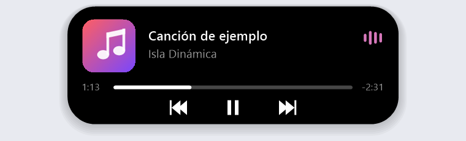
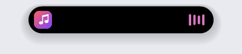

# Isla Dinámica para Windows

Una "Dynamic Island" al estilo Apple para Windows 10 y 11: una píldora negra arriba al centro de la pantalla que muestra lo que estás escuchando o viendo, y que no estorba al resto de tus ventanas.

*[English below](#english)*

<p align="center">
  <br>
  
</p>

## Qué hace

- **En reposo:** solo se ve una píldora negra pequeña. Los clics la atraviesan, así que nunca tapa ni bloquea lo que está debajo.
- **Cuando algo suena:** se alarga y muestra la carátula con unas barras animadas del color de esa carátula. Funciona con Spotify, YouTube en Chrome, Edge o Firefox, VLC y cualquier app que use los controles de medios de Windows.
- **Al cambiar de canción** se abre unos segundos. Al pasar el mouse se expande con título, artista, barra de progreso y botones de anterior, pausa y siguiente.
- **Pantalla completa:** se esconde sola en juegos y videos.
- **Ligera:** unos 30 MB de RAM propia y menos del 0.5 % de CPU mientras suena música. No usa Electron ni navegador.
- **Privada:** no se conecta a internet ni guarda nada. Solo lee lo que Windows ya muestra en sus controles de medios.

## Instalar

1. Descarga `IslaDinamica-vX.Y.Z.zip` desde [Releases](../../releases/latest) y descomprímelo.
2. Doble clic en **`instalar.cmd`**. Te pregunta si quieres que se abra sola al iniciar Windows.
3. Listo: la isla aparece arriba al centro.

> El programa no está firmado digitalmente, así que Windows SmartScreen puede mostrar un aviso la primera vez. Pulsa **Más información** y luego **Ejecutar de todas formas**. Si prefieres no confiar en un `.exe` ajeno, puedes compilarlo tú mismo desde el código (ver abajo).

**Cerrar:** clic derecho sobre la isla abierta y "Cerrar Isla Dinámica", o el acceso "Cerrar Isla Dinámica" del menú Inicio.
**Desinstalar:** doble clic en `desinstalar.cmd`.

## Compilar desde el código

No hace falta Visual Studio ni el SDK de .NET: usa el compilador de C# que ya trae Windows (.NET Framework 4.x).

```powershell
powershell -ExecutionPolicy Bypass -File .\compilar.ps1
```

Eso genera `Isla.exe` junto al código. Después ejecuta `instalar.cmd`.

`Isla.exe --demo` muestra la isla con una canción de ejemplo, útil para probar el diseño sin música.

## Requisitos

- Windows 10 (versión 1809 o posterior) o Windows 11, de 64 bits.
- .NET Framework 4.8, que ya viene con Windows 10 y 11.

## Cómo está hecha

- **Lenguaje:** un solo archivo en C# ([`Isla.cs`](Isla.cs)), con WinForms y una ventana en capas (`UpdateLayeredWindow`) para tener transparencia por píxel y bordes suaves.
- **Datos de lo que suena:** la API de controles de medios de Windows (`GlobalSystemMediaTransportControlsSessionManager`).
- **Animaciones:** de resorte. La ventana solo se redibuja mientras algo se mueve.
- **Personalizar:** los tamaños están en constantes al principio de `Isla.cs` (`IDLE_W`, `COMP_W`, `EXP_W`…). Cámbialos y vuelve a compilar.

## Licencia

[MIT](LICENSE). Úsala, cámbiala y compártela libremente.

---

## English

**Isla Dinámica** is an Apple-style Dynamic Island for Windows 10/11: a small black pill at the top center of the screen that shows what is playing and stays out of the way.

- **Idle:** just a small black pill. It is click-through, so it never blocks the windows under it.
- **Playing:** grows to show the album art and animated bars tinted with the art's color. Works with Spotify, YouTube in Chrome, Edge or Firefox, VLC and any app that uses Windows media controls.
- **Expanded:** opens for a few seconds on track change, or on hover. Shows title, artist, a progress bar and previous / play-pause / next buttons.
- **Full screen:** hides automatically during games and videos.
- **Lightweight:** about 30 MB of private memory and under 0.5 % CPU while music plays. No Electron, no browser.
- **Private:** no network access and no data stored.

**Install:** download the zip from [Releases](../../releases/latest), unzip it and run `instalar.cmd`. The app is not code-signed, so SmartScreen may warn you the first time: choose **More info**, then **Run anyway**, or build it yourself with `compilar.ps1`. It only needs the C# compiler that ships with Windows.
**Uninstall:** run `desinstalar.cmd`.

License: MIT.
